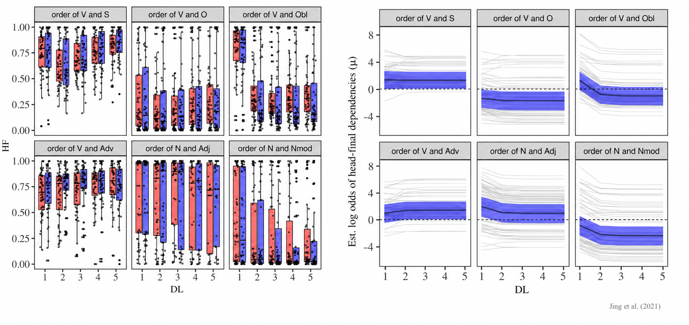
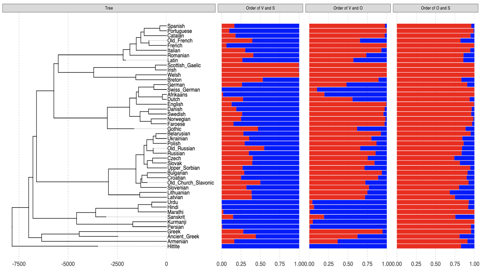

I am currently an assistant professor at the Institute of Modern Languages and Linguistics, Fudan University. Before that, I got my Ph.D. at the Department of Comparative Language Science, University of Zürich, with a background of **linguistic typology** and **language evolution**. My research sits at the intersection of quantitative typology, comparative linguistics, and multilingual NLP, and explores the dynamics of language systems from two complementary perspectives:

💡 ***If you are interested in pursuing a Ph.D. at Fudan University, please feel free to contact me.***

A data-driven approach
==========

Language shapes the world we live in. We communicate through language, and the languages we acquire may, in turn, influence how we think and behave. To better understand language and ourselves, we need a data-driven approach, particularly in the digital age. I am interested in a wide range of linguistic data, including movie subtitles, Wikipedia data, parallel corpora, and dependency treebanks across different languages. The availability of large-scale cross-linguistic data provides valuable opportunities to for us investigate the structural diversity of languages and the constraints that shape language use. I am particularly interested in how languages are used, how their structures emerge, and what factors drive linguistic diversity across the world's languages.

An evolutionary approach
==========

Languages are constantly evolving! The languages we use today carry traces of where we come from and how our linguistic systems have developed. Much like genes, languages preserve information about their histories of transmission and diversification. Comparative methods, particularly phylogenetic inference, allow us to reconstruct language histories and investigate how linguistic features evolve across time and space. Linguistic change may be shaped by a range of factors, including language processing, production, and learning. I am interested in modeling the evolutionary dynamics of language systems, and investigating how functional pressures may be reflected in, and detected throughout, the entire history of language phylogenies. 

  

